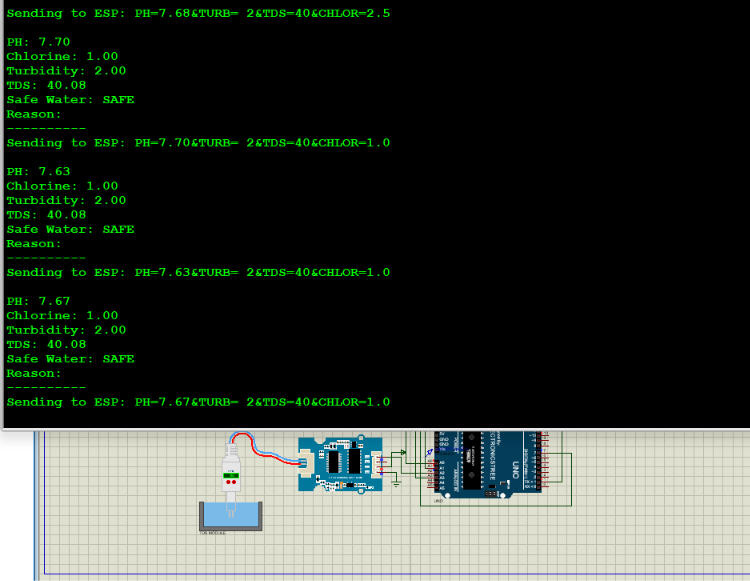

# Water Quality Monitoring (IoT): Arduino + ESP8266, simulated in Proteus and Cisco Packet Tracer

A university IoT project that monitors water quality (pH, turbidity, TDS, chlorine), decides whether the water is safe, and sends the readings toward a server. The hardware side is simulated in **Proteus** (Arduino UNO + sensors + ESP8266), and the network side (sensor node to gateway to IoT server) is simulated in **Cisco Packet Tracer (IoT mode)**.


## Why this project

Egypt's Vision 2030 puts weight on sustainable water management and smart infrastructure. Water quality is usually checked manually, at specific times and places. A continuous sensor node can report problems as they happen (a pH drop in a canal, a turbidity spike at a treatment plant intake) instead of weeks later.

## What is implemented (and what is not)

| Implemented | Not implemented (future work) |
|---|---|
| Proteus circuit: Arduino UNO, pH, turbidity, TDS, chlorine inputs, ESP8266 | Real hardware build and sensor calibration |
| Firmware: reads sensors, converts to units, checks safe limits, prints a report | Actuators (relay, dosing pump, valve) |
| Data sent to the ESP8266 over SoftwareSerial | MQTT broker, database, dashboard (planned below) |
| Packet Tracer network: sensor node to Home Gateway to IoT Server | Modbus-RTU / 4-20 mA (discussed in the report only) |

**Important:** all readings in this repo come from simulation, not from real sensors. The chlorine input is a potentiometer because no chlorine sensor model exists in Proteus.

## Architecture

```
 pH / turbidity / TDS / chlorine
              |  analog (A0-A3)
        Arduino UNO ---- USB Serial (9600) ----> readable report (or JSON)
              |
        SoftwareSerial (pins 10/11)
              |
          ESP8266 ---- Wi-Fi ----> Home Gateway ----> IoT Server   (Packet Tracer)
```

### Pin map

| Signal | Pin | Simulation input |
|---|---|---|
| pH | A0 | pH meter module (controlled by RV1) |
| Turbidity | A1 | Turbidity module TSM1 (red up/down buttons) |
| TDS | A2 | TDS module TDSM1 (red up/down buttons) |
| Chlorine | A3 | Potentiometer (POT1) |
| ESP8266 RX / TX | 11 / 10 | SoftwareSerial |

## Firmware

File: [`firmware/water_monitor/water_monitor.ino`](firmware/water_monitor/water_monitor.ino)

- Reads the four sensors and converts voltage to units. **The conversion formulas are tuned for the simulation.** A real build needs calibration (pH with buffer solutions, TDS with temperature compensation).
- Prints one report every 2 seconds (`REPORT_INTERVAL_MS`).
- The pH reading uses a moving average (a sample every 200 ms, the last 50 samples, about 10 s), because the pH module's output swings in simulation.
- Safe limits: pH 6.5 to 8.5, chlorine 0.2 to 2.0 mg/L, turbidity up to 50 NTU, TDS up to 500 ppm. Every violated parameter is listed in `Reason`.
- `#define JSON_OUTPUT 1` switches the Serial output to one JSON line per reading, for scripts.

Default output on USB Serial (9600 baud):

```
PH: 7.77
Chlorine: 4.00
Turbidity: 270.00
TDS: 40.08
Safe Water: UNSAFE
Reason: Chlorine, Turbidity
----------
Sending to ESP: PH=7.77&TURB=270&TDS=40&CHLOR=4.0
```

With `JSON_OUTPUT 1`:

```json
{"ph":6.99,"chlorine":4.88,"turbidity":0.0,"tds":880,"safe":false,"reasons":["Chlorine","TDS"]}
```

The line sent to the ESP8266 keeps the same format as the original version (`PH=...&TURB=...&TDS=...&CHLOR=...`).

An earlier version of the sketch is kept in [`firmware/legacy/`](firmware/legacy/) for reference.

## Packet Tracer (network side)

File: `packet-tracer/iot_water_monitoring.pkt`

Packet Tracer's IoT library does not include pH, TDS or turbidity sensors, so generic sensors stand in for them. This simulation proves the **data path**: the MCU registers on the IoT Server over Wi-Fi through the Home Gateway. It is a separate simulation from the Proteus one; data does not flow between them.

Addressing used: MCU1 `192.168.25.100`, Server1 `192.168.25.102`, Home Gateway LAN `192.168.25.1`.

## How to run

**Required Proteus libraries**

The turbidity, TDS and pH modules are third-party Proteus models. Install them first, otherwise Proteus falls back to a cached model with no analog output and the readings stay constant.

| Module | Source | In this repo |
|---|---|---|
| Turbidity sensor | ElectronicsTree | `libraries/Electronics-Tree-Turbidity-Sensor-Library.rar` |
| TDS module | ElectronicsTree | `libraries/Electronics-Tree-TDS-Module-Library.rar` |
| pH meter | *pH Sensor Library for Proteus*, The Engineering Projects | not included, download from the author |

The libraries belong to their authors and are included only for convenience; they will be removed on request. To install: extract each archive, copy the contents of its `LIB` folder into Proteus's Library folder and the contents of its `MODEL` folder into Proteus's Models folder (paths are under *System, Set Paths*), then restart Proteus.

**Proteus part**
1. Tested with Proteus **8.13**, with the **AVR/microcontroller simulation licence**. The simulation may run slower than real time on a weak machine.
2. Open `proteus/iot_v2.pdsprj`.
3. Double-click **UNO1** and set *Program File* to `proteus/water_monitor.ino.hex`.
4. The pH meter module needs its own hex from the *pH Sensor Library for Proteus*. It is not included here; download it from the library's page, put it next to the project, and set it as the Program File of **PH2**.
5. Press Play. The Virtual Terminal (9600 baud) prints the report. Use the red up/down buttons on the turbidity and TDS modules, the potentiometer for chlorine, and RV1 for pH.

**Rebuilding the firmware:** open `firmware/water_monitor/water_monitor.ino` in the Arduino IDE, select *Arduino Uno*, then *Sketch, Export Compiled Binary*, and use the `.hex` without `with_bootloader`.




## Challenges and how they were solved

| Problem | Solution |
|---|---|
| MCU1 could not reach Server1 in Packet Tracer | The Home Gateway itself was not set to `192.168.25.1`; fixed in its LAN settings |
| Raw ADC values (0 to 1023) are meaningless to a user | Convert to voltage, then to pH / ppm / NTU in `readSensors()` |
| pH, TDS and turbidity sensors exist in Proteus but not in Packet Tracer | Split the goals: Proteus for the hardware, Packet Tracer for the network, with generic stand-in sensors |
| No chlorine sensor in Proteus | Potentiometer on A3 simulates it |
| Project would not open (created in a newer Proteus, 8.17 or later) | Opened it on a newer installation |
| Compile error: `setup()` and `loop()` redefined | An old `.ino` was in the same sketch folder (Arduino merges all `.ino` files in a folder); moved it out |
| `Bad or missing Customer Key` for AVR2.DLL | The Proteus install had no AVR simulation licence; used a licensed one |
| Proteus could not find the hex files after the project was moved | Keep the hex files next to the project and re-select them in each part's *Program File* |
| Turbidity and TDS stayed at constant values (500 and 0); the log said `Pin 'ET_A0' is not modelled` and a voltage probe on the output read `FLT` (floating) | The modules' library files were not installed, so Proteus used a stripped cached model. Installing the `LIB` and `MODEL` files fixed it |
| pH reading swung between about 6 and 8.6 with the control fixed | Added a 10 s moving average in the firmware |
| Readings scrolled too fast to read | Replaced the 100 ms delay with a 2 s report interval |

## Future work

- MQTT pipeline with `docker-compose`: Mosquitto, InfluxDB, Grafana, plus a Python script that reads the Serial JSON and publishes it.
- GitHub Actions: compile the firmware with `arduino-cli` on every push.
- Actuators: relay-driven dosing pump or valve for chlorine and TDS correction.
- Real calibration on hardware.

## Repository structure

```
water-quality-monitoring/
├── README.md
├── docs/                 screenshots and demo (docs/legacy has older ones)
├── firmware/
│   ├── water_monitor/    current firmware
│   └── legacy/           earlier version
├── libraries/            third-party Proteus libraries (see above)
├── proteus/              .pdsprj and compiled .hex
└── packet-tracer/        .pkt
```

## Credits

- Turbidity and TDS models: ElectronicsTree. pH meter model: *pH Sensor Library for Proteus*, The Engineering Projects.
- Course assignment: IoT, New Cairo Technological University.

**Author:** [your name] · [LinkedIn]
