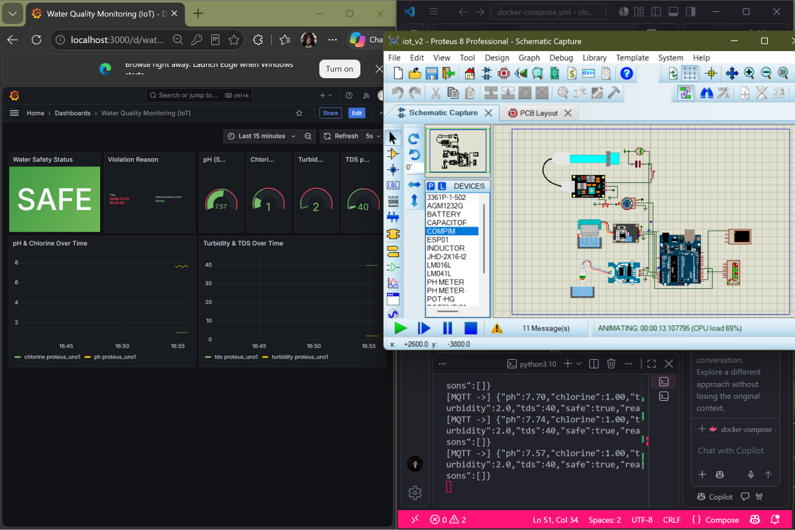
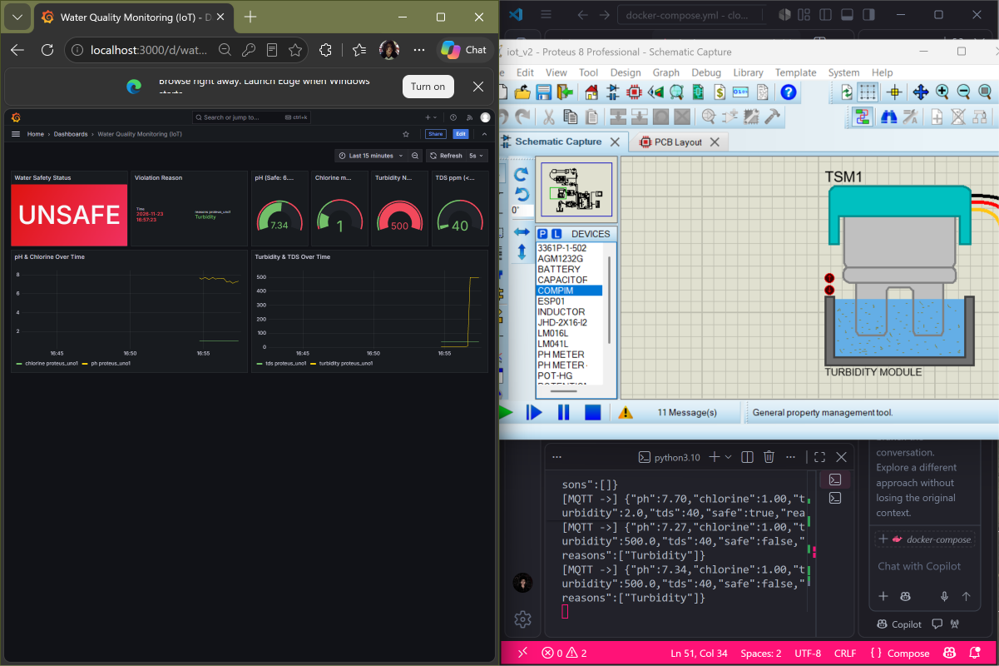
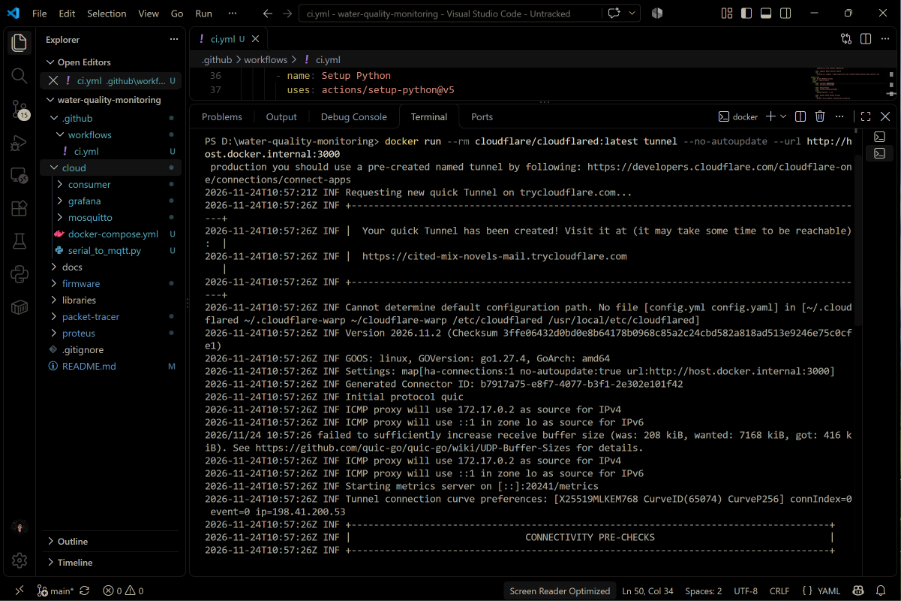

# 💧 Water Quality Monitoring: End-to-End IoT & Cloud Telemetry Pipeline

**Embedded Sensing (Arduino UNO) · Dual-Platform Simulation (Proteus & Cisco Packet Tracer) · Containerized Cloud Telemetry (Docker Compose, Mosquitto MQTT, InfluxDB, Grafana) · CI/CD (GitHub Actions) · Edge Tunnel (Cloudflare)**


A comprehensive university IoT project that originated as an embedded systems assignment and was refactored and evolved into a production-grade, containerized **Cloud & DevOps Telemetry Pipeline**. 

The system continuously samples water quality parameters (**pH, turbidity, TDS, and chlorine**), evaluates localized safety limits on embedded firmware, bridges data across virtualized serial buses to an asynchronous **MQTT broker**, persists time-series telemetry into **InfluxDB v2**, visualizes live metrics on **Grafana 11.4** dashboards (provisioned entirely as code), and securely exposes the monitoring interface to the public web via a zero-trust **Cloudflare Tunnel**.

---

## 📌 Table of Contents
- [Why This Project](#-why-this-project)
- [Project Evolution: From Packet Tracer to Cloud](#-project-evolution-from-packet-tracer-to-cloud)
- [Live Visualizations & Circuit Demos](#-live-visualizations--circuit-demos)
- [System Architecture](#-system-architecture)
- [Pin Map & Physical Thresholds](#-pin-map--physical-thresholds)
- [Firmware & Output Modes](#-firmware--output-modes)
- [Network Simulation (Cisco Packet Tracer)](#-network-simulation-cisco-packet-tracer)
- [Proteus Simulation & Required Libraries](#-proteus-simulation--required-libraries)
- [Containerized Cloud Stack (Docker Compose)](#-containerized-cloud-stack-docker-compose)
- [CI/CD Automation (GitHub Actions)](#-cicd-automation-github-actions)
- [How to Run the Entire System](#-how-to-run-the-entire-system)
- [Deep-Dive Engineering Challenges & Solutions](#-deep-dive-engineering-challenges--solutions)
- [Repository Structure](#-repository-structure)
- [Credits & Author](#-credits--author)

---

## 🌍 Why This Project

Egypt's **Vision 2030** puts weight on sustainable water management and smart infrastructure. Water quality is usually checked manually, at specific times and places. A continuous sensor node can report problems as they happen (a pH drop in a canal, a turbidity spike at a treatment plant intake) instead of weeks later.

---

## 🚀 Project Evolution: From Packet Tracer to Cloud

1. **The Academic Prototype:** The original university assignment was split into two separate simulations: Proteus for the circuit/firmware and Packet Tracer for the network path using generic sensors.
2. **The Catalyst:** While Packet Tracer proved the data path (MCU1 registering on the IoT Server through the Home Gateway), its IoT library lacked specialized water chemistry sensors (pH, TDS, Turbidity). Furthermore, the Proteus simulation initially suffered from unmodeled floating pins (`FLT`) and noisy simulated swings.
3. **The Engineering Pivot:** Rather than settling for disconnected academic models, the system was refactored end-to-end:
   - Root causes of Proteus module floating pins (`FLT`) were solved by installing vendor model libraries.
   - Firmware was overhauled with a 50-sample moving-average filter and complete violation aggregation.
   - A full **DevOps telemetry pipeline** was constructed to bridge Proteus serial streams over a virtual null-modem cable into a containerized microservices stack (**Mosquitto**, **InfluxDB**, **Grafana**), automated with **GitHub Actions CI** and exposed globally via a zero-trust **Cloudflare Tunnel**.

---

## 🎥 Live Visualizations & Circuit Demos


## Circuit


### 1. Real-Time Grafana Telemetry Dashboard (Safe vs Unsafe)
| Normal Safe Operating State | Real-Time Violation Alert (Turbidity Spike) |
| :---: | :---: |
|  |  |

### 2. Public Edge Tunnel (Cloudflare)
The localized Docker environment is securely routed to the public internet with end-to-end encryption via Cloudflare Tunnel:


### 3. Proteus Virtual Terminal Stream
| Safe Reading | Unsafe Reading |
| :---: | :---: |
|  |  |

---

## 🏗️ System Architecture

```text
  pH / Turbidity / TDS / Chlorine
               │
               ▼ Analog (A0 - A3)
   ┌───────────────────────────────────────────────┐
   │            Arduino UNO (Firmware)             │
   │  • 10s Moving-Average Filter (pH)             │
   │  • Multi-Parameter Safety Limits Evaluator    │
   │  • Dual-Mode Output (Text Report / JSON)      │
   └───────┬───────────────────────────────┬───────┘
           │ Hardware Serial (Pin 1 TX)    │ SoftwareSerial (Pins 10/11)
           ▼                               ▼
     [COMPIM (COM8)]               [ESP8266 Wi-Fi Node]
           │                               │
     (Virtual Null-Modem: com0com)         ▼ (Wi-Fi 802.11)
           │                        [Home Gateway (192.168.25.1)]
           ▼                               │
     [COM9 Serial Port]                    ▼ (FastEthernet)
           │                        [IoT Server (192.168.25.102)]
           ▼                        (Packet Tracer Topology)
 [serial_to_mqtt.py (Host Bridge)]
           │
           ▼ MQTT Publish (Port 1883 | Topic: water/telemetry)
 ┌────────────────────────────────────────────────────────────────────────┐
 │                      Docker Compose Microservices                      │
 │                                                                        │
 │  ┌───────────────────────┐         ┌────────────────────────────────┐  │
 │  │   Eclipse Mosquitto   │────────▶│      mqtt-consumer (Python)    │  │
 │  │      MQTT Broker      │         │   Parses JSON & Writes Points  │  │
 │  └───────────────────────┘         └───────────────┬────────────────┘  │
 │                                                    ▼                   │
 │  ┌───────────────────────┐         ┌────────────────────────────────┐  │
 │  │      Grafana 11.4     │◀────────│          InfluxDB v2           │  │
 │  │  Dashboards as Code   │  Flux   │       Time-Series Engine       │  │
 │  └──────────┬────────────┘ Queries └────────────────────────────────┘  │
 └─────────────┼──────────────────────────────────────────────────────────┘
               │ Localhost:3000
               ▼
   [Cloudflare Secure Edge Tunnel] ────▶ Public Web (https://*.trycloudflare.com)
```

---

## 📌 Pin Map & Physical Thresholds

### Pin Mapping
| Signal | Pin | Simulation Input | Description |
|---|---|---|---|
| **pH** | `A0` | pH meter module (`PH2` via `RV1`) | Controlled by potentiometer `RV1` |
| **Turbidity** | `A1` | Turbidity module `TSM1` | Hardware simulation with red up/down buttons |
| **TDS** | `A2` | TDS module `TDSM1` | Hardware simulation with red up/down buttons |
| **Chlorine** | `A3` | Potentiometer (`POT1`) | Simulates sensor output (0–5V) |
| **Host Bridge TX**| `Pin 1`| `COMPIM` (`P1`) Pin 3 (`TXD`) | Parallel-tapped to hardware serial TX |
| **ESP8266 RX/TX** | `11 / 10`| `SoftwareSerial` | Legacy transmission path |

### Safe Water Limits
| Parameter | Safe Limit | Unit | Violation Criteria |
|---|---|---|---|
| **pH** | `6.5` – `8.5` | pH | Flagged if `< 6.5` or `> 8.5` |
| **Chlorine** | `0.2` – `2.0` | mg/L | Flagged if `< 0.2` or `> 2.0` |
| **Turbidity** | `≤ 50` | NTU | Flagged if `> 50.0` |
| **TDS** | `≤ 500` | ppm | Flagged if `> 500` |

---

## 💻 Firmware & Output Modes

**File:** [`firmware/water_monitor/water_monitor.ino`](firmware/water_monitor/water_monitor.ino)  
*(An earlier version of the sketch is preserved in [`firmware/legacy/`](firmware/legacy/) for reference).*

- Reads the four sensors and converts voltage to units. **The conversion formulas are tuned for the simulation.** A real build requires calibration (pH with buffer solutions, TDS with temperature compensation).
- Prints one report every 2 seconds (`REPORT_INTERVAL_MS`).
- The pH reading uses a moving average (a sample every 200 ms, across 50 samples, ~10 s window) because the pH module's output swings in simulation.
- Checks safe limits and lists **every** violated parameter in `Reason`.

### 1. Default Output on USB Serial (9600 baud)
```text
PH: 7.77
Chlorine: 4.00
Turbidity: 270.00
TDS: 40.08
Safe Water: UNSAFE
Reason: Chlorine, Turbidity
----------
Sending to ESP: PH=7.77&TURB=270&TDS=40&CHLOR=4.0
```

### 2. JSON Mode (`#define JSON_OUTPUT 1`)
Emits a compact single-line JSON string per cycle for scripts and MQTT bridges:
```json
{"ph":6.99,"chlorine":4.88,"turbidity":0.0,"tds":880,"safe":false,"reasons":["Chlorine","TDS"]}
```

The line sent to the ESP8266 maintains the original legacy format:
`PH=...&TURB=...&TDS=...&CHLOR=...`.

---

## 🌐 Network Simulation (Cisco Packet Tracer)

**File:** `packet-tracer/iot_water_monitoring.pkt`

Packet Tracer's IoT library does not include pH, TDS, or turbidity sensors, so generic sensors stand in for them. This simulation proves the **data path**: the MCU registers on the IoT Server over Wi-Fi through the Home Gateway. It is a separate simulation from the Proteus one; data does not bridge directly between them.

| Device | IP Address | Role | Configuration |
|---|---|---|---|
| **Home Gateway (LAN)** | `192.168.25.1` | Local Wi-Fi Gateway | DHCP Server & WPA2 Access Point |
| **MCU1** | `192.168.25.100` | IoT Sensor Node | Connects via `PT-IOT-NM-1W` Wi-Fi adapter |
| **Server1** | `192.168.25.102` | IoT Registration Server | Runs IoT & HTTP daemons |

---

## 🔬 Proteus Simulation & Required Libraries

### Required Proteus Libraries
The turbidity, TDS, and pH modules are third-party Proteus models. Install them first; otherwise Proteus falls back to a cached model with no analog output and the readings stay constant:

| Module | Source | In This Repo | Installation Instructions |
|---|---|---|---|
| **Turbidity sensor** | ElectronicsTree | `libraries/Electronics-Tree-Turbidity-Sensor-Library.rar` | Copy `LIB` content to Proteus `LIBRARY/` and `MODEL` content to `MODELS/` |
| **TDS module** | ElectronicsTree | `libraries/Electronics-Tree-TDS-Module-Library.rar` | Copy `LIB` content to Proteus `LIBRARY/` and `MODEL` content to `MODELS/` |
| **pH meter** | *pH Sensor Library for Proteus*, The Engineering Projects | Not included — download from author | Place the downloaded `.hex` file alongside the project |

> [!NOTE]
> The included libraries belong to their respective authors and are included only for convenience; they will be removed on request. Proteus paths can be verified under **System → Set Paths**.

### Running Proteus
1. Requires **Proteus 8.17 or later**, with the **AVR/microcontroller simulation license**.
2. Open `proteus/iot_v2.pdsprj`.
3. Double-click **`UNO1`** and set *Program File* to `proteus/water_monitor.ino.hex`.
4. Set the downloaded pH hex file as the *Program File* of **`PH2`**.
5. Press **Play**. The Virtual Terminal (9600 baud) prints the report. Use the red up/down buttons on the turbidity and TDS modules, `POT1` for chlorine, and `RV1` for pH.

**Rebuilding the firmware:** Open `firmware/water_monitor/water_monitor.ino` in the Arduino IDE, select *Arduino Uno*, go to *Sketch → Export Compiled Binary*, and use the `.hex` file without `with_bootloader`.

---

## 🐳 Containerized Cloud Stack (Docker Compose)

The backend telemetry infrastructure is configured via Infrastructure as Code inside `cloud/docker-compose.yml`:

| Service | Image | Internal Port | External Port | Function |
|---|---|---|---|---|
| **`mosquitto`** | `eclipse-mosquitto:2` | `1883` | `1883` | Asynchronous MQTT message broker |
| **`influxdb`** | `influxdb:2` | `8086` | `8086` | Time-series database engine |
| **`mqtt-consumer`**| Custom Python 3.11 | — | — | Microservice parsing MQTT payloads into InfluxDB Points |
| **`grafana`** | `grafana/grafana:11.4.0` | `3000` | `3000` | Dashboards as Code visualization engine |

### Dashboards as Code (Declarative Provisioning)
- `cloud/grafana/provisioning/datasources/influxdb.yml`: Auto-links InfluxDB with Flux query support and pre-shared tokens.
- `cloud/grafana/provisioning/dashboards/dashboards.yml` & `water-quality.json`: Auto-provisions the 8-panel dashboard (gauges, historical time-series, and dynamic `SAFE` / `UNSAFE` alert cards).

---

## 🔄 CI/CD Automation (GitHub Actions)

**Workflow File:** [`.github/workflows/ci.yml`](.github/workflows/ci.yml)

Every `git push` or `pull_request` triggers automated checks on `ubuntu-latest`:
1. **Arduino Firmware Compilation:** Uses `arduino-cli` to compile `water_monitor.ino` against the `arduino:avr` core.
2. **Python Quality Gate:** Compiles and lint-checks all Python bridge scripts for syntax errors.
3. **Docker Compose Validation:** Validates compose service schemas and builds the `mqtt-consumer` container image.

---

## 🛠️ How to Run the Entire System

### 1. Launch Cloud Services
```powershell
cd cloud
docker compose up -d
```

### 2. Configure Virtual Null-Modem Ports
Using `com0com`, configure an unreserved pair (e.g., `COM8` and `COM9`):
- Set `COMPIM` (`P1`) in Proteus to `COM8` at `9600` baud.
- Set `COM_PORT = "COM9"` in `cloud/serial_to_mqtt.py`.

### 3. Start Telemetry Bridge & Simulation
In your terminal:
```powershell
cd cloud
python serial_to_mqtt.py
```
Open `proteus/iot_v2.pdsprj` and click **Play**.

### 4. Open the Dashboards
- **Locally:** Open `http://127.0.0.1:3000` (User: `admin` | Pass: `admin123`).
- **Publicly via Cloudflare Tunnel:**
  ```powershell
  docker run --rm cloudflare/cloudflared:latest tunnel --no-autoupdate --url http://host.docker.internal:3000
  ```
  Access the generated `https://*.trycloudflare.com` URL from any browser or mobile device.

---

## 🛠️ Deep-Dive Engineering Challenges & Solutions

| Problem / Symptom | Root Cause | Engineering Solution |
|---|---|---|
| **MCU1 could not reach Server1 in Packet Tracer** | The Home Gateway itself was not set to `192.168.25.1`; Server1 lacked IP and daemons were `Off`. | Configured Gateway LAN IP to `192.168.25.1`, assigned Server1 to `192.168.25.102`, and enabled IoT/HTTP services. |
| **Raw ADC values (0–1023) meaningless to user** | Raw analog counts require calibration transfer functions. | Converted ADC readings to voltage, then to physical units (pH, ppm, NTU) in `readSensors()`. |
| **Missing specialized sensors in Packet Tracer** | Packet Tracer's library contains no dedicated pH or TDS sensors. | Split project goals: Proteus for true hardware chemistry; Packet Tracer for networking proof-of-concept. |
| **Turbidity & TDS stayed at constant values (`500` and `0`)** | Log said `Pin 'ET_A0' is not modelled`; output pin was floating (`FLT`) because library files were uninstalled. | Installed vendor `LIB` and `MODEL` binaries into Proteus system paths to enable interactive modules. |
| **pH reading swung between ~6.0 and ~8.6** | Simulated op-amp module had analog noise swings. | Implemented a 50-sample (10-second) circular buffer moving-average filter in firmware. |
| **No chlorine sensor model in Proteus** | Proteus lacks commercial amperometric chlorine models. | Engineered an analog voltage-divider proxy using potentiometer `POT1` mapped to `0.2–2.0 mg/L`. |
| **Readings scrolled too fast on terminal** | Initial loop delay was set to `100 ms`. | Replaced with a controlled `2000 ms` reporting interval (`REPORT_INTERVAL_MS`). |
| **Compile error: `setup()` and `loop()` redefined** | Arduino IDE merges all `.ino` files in the same directory; old sketch was present. | Isolated earlier sketch versions into a separate `legacy/` directory. |
| **`Bad or missing Customer Key` for AVR2.DLL** | Proteus installation lacked an AVR microcontroller simulation license. | Upgraded to a licensed environment supporting AVR microcontroller simulation. |
| **Proteus lost `.hex` file paths after moving project** | Relative path binding broke after repository restructuring. | Kept `.hex` binaries adjacent to `.pdsprj` and re-linked each component's *Program File*. |
| **Serial bus contention on Pin 1 (`TX`)** | Both Virtual Terminal and `COMPIM` required output from Pin 1. | Parallel-spliced `TXD` to Pin 1 while leaving `COMPIM` `RXD` floating to avoid reverse-bias contention. |
| **`com0com` GUI error requesting `.NET 2.0`** | Windows 11 lacks pre-installed legacy .NET 2.0 runtime. | Bypassed GUI; utilized the native command-line utility (`setupc.exe`) to configure virtual pairs. |
| **`COM5` port conflict on host** | OS reported `COM5 is already used by \Device\USBSER000`. | Scanned free ports with `busynames` and allocated unreserved ports `COM8` and `COM9`. |
| **`NameError: name 'SYNCHRONOUS' is not defined`** | Missing import inside `mqtt_to_influx.py` during container runtime. | Corrected import from `influxdb_client.client.write_api` and rebuilt container with `--build`. |
| **Grafana 12 provisioning crash-loop** | `grafana:latest` (v12.3) bug crashes on datasource UID provisioning with pre-existing volumes. | Pinned the stable LTS release `grafana/grafana:11.4.0` in Compose and purged stale volumes with `docker compose down -v`. |
| **The WSL2 Sleep Clock Drift Bug** | Windows sleep froze WSL2 Linux kernel time; new points were back-dated 18 hours, leaving "Last 15m" empty. | Diagnosed timestamp divergence in InfluxDB; restarted Docker Desktop daemon to synchronize hardware clock. |

---

## 📁 Repository Structure

```text
water-quality-monitoring/
├── .github/
│   └── workflows/
│       └── ci.yml               # Automated CI pipeline (Arduino CLI + Python + Docker)
├── cloud/
│   ├── consumer/
│   │   ├── Dockerfile           # Python MQTT-to-Influx consumer image
│   │   ├── mqtt_to_influx.py    # InfluxDB Point writer
│   │   └── requirements.txt     # Python dependencies
│   ├── grafana/
│   │   └── provisioning/
│   │       ├── dashboards/
│   │       │   ├── dashboards.yml       # Dashboard provider configuration
│   │       │   └── water-quality.json   # 8-panel dashboard as code
│   │       └── datasources/
│   │           └── influxdb.yml         # Auto-provisioned InfluxDB datasource
│   ├── mosquitto/
│   │   └── mosquitto.conf       # Lightweight MQTT broker configuration
│   ├── docker-compose.yml       # 4-service cloud orchestration
│   └── serial_to_mqtt.py        # Host-level serial-to-MQTT telemetry bridge
├── docs/                        # Visual architecture, dashboards, and circuit captures
│   ├── circuit.png              # Proteus schematic diagram
│   ├── cloudflare-tunnel.png    # Cloudflare public edge tunnel deployment
│   ├── dashboard-safe.png       # Live Grafana dashboard (normal safe state)
│   ├── dashboard-unsafe.png     # Live Grafana dashboard (violation alert)
│   ├── terminal-safe.png        # Serial terminal safe output
│   └── terminal-unsafe.png      # Serial terminal violation output
├── firmware/
│   ├── legacy/                  # Initial academic sketch
│   └── water_monitor/
│       └── water_monitor.ino    # Production Arduino firmware (moving avg, JSON mode)
├── libraries/                   # Third-party Proteus sensor libraries (ElectronicsTree)
│   ├── Electronics-Tree-TDS-Module-Library.rar
│   └── Electronics-Tree-Turbidity-Sensor-Library.rar
├── packet-tracer/
│   └── iot_water_monitoring.pkt # Cisco Packet Tracer IoT network simulation
└── proteus/
    ├── iot_v2.pdsprj            # Complete Proteus 8.17+ schematic
    └── water_monitor.ino.hex    # Pre-compiled firmware binary
```

---

## 🙌 Credits & Author

- **Academic Context:** IoT Course Assignment — **New Cairo Technological University**.
- **Third-Party Simulation Models:**
  - *pH Sensor Library for Proteus* by The Engineering Projects.
  - *Turbidity Sensor & TDS Module Libraries* by ElectronicsTree.

**Author:** Iman · [LinkedIn](https://www.linkedin.com/in/imansabeq/)
